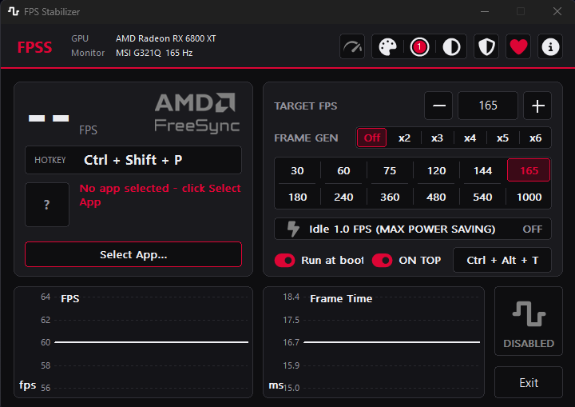

# FPSS (FPS Stabilizer)

##
**SHA-256:** `fcd43c9a2571066e641a6bd45518542086e446481a841dd9ee7bd8a90f153e01`

##FPSS (FPS Stabilizer)** is a lightweight utility designed to eliminate screen tearing, reduce input latency, and optimize power consumption by intelligently managing your game's frame rates. By aligning your hardware output with your display’s capabilities, FPSS ensures the smoothest possible gaming experience.

---

  

## 🚀 Key Features

### 🔌 Hardware-Aware UI & Branding
* **GPU Brand Detection:** Automatically identifies your graphics card vendor (NVIDIA, AMD, or Intel) upon startup.
* **Dynamic Theme Customization:** Automatically changes its default UI accent colors and brand styling to match your specific GPU ecosystem.
* **Contextual Sync Logos:** Dynamically displays the appropriate **G-Sync, FreeSync, Adaptive-Sync, or VRR** branding assets based on your exact hardware configuration.

### 🎨 Personalization & Themes
* **3 Main Theme Modes:** Choose between **Dark**, **Light**, or a modern, sleek **Glass-like (Aero/Acrylic)** aesthetic to perfectly match your desktop setup.
* **12 Vibrant Presets:** Switch UI accent colors instantly using twelve carefully designed, one-click color presets.
* **Full Custom Color Picker:** Tailor the application's appearance exactly to your liking with an advanced color wheel/picker for limitless accent customization.

### 🧠 Smart Automation & Profiles
* **Per-App Configuration:** Automatically saves and remembers unique configurations, targets, and limits for every single game or application you configure.
* **Instant Auto-Apply:** Detects when a game launches and seamlessly applies its most recent settings in the background without requiring manual profile switching.
* **Auto-Admin Privilege Detection:** Automatically identifies if a protected target game requires administrative rights to be intercepted, proactively prompting you to relaunch FPSS with the necessary permissions.

### 🎮 Performance & Sync Optimization
* **Hardware-Driven FPS Target:** Reads your monitor's exact current refresh rate (Hertz) to calculate the precise sub-refresh ceiling required to perfectly engage variable refresh rate technologies.
* **Seamless Sync Integration:** Built specifically to trigger and maintain sync technologies without falling into the high-latency traps of traditional V-Sync.
* **Custom FPS Limiter:** Allows users to manually input any preferred target frame rate to perfectly match their hardware performance.
* **Ultra-Low Latency:** Engineered to cap frame rates with precision, avoiding the frame-pacing queues that introduce input lag.

### 📊 Real-Time Telemetry
* **FPS & Frame Time Graphs:** Features built-in, real-time diagnostic graphs to visually track performance.
* **Jitter Detection:** Easily spot frame time instability, micro-stutters, and performance spikes while tweaking your settings.
* **Adjustable Graph Refresh Rate:** Toggle between high-frequency polling for an ultra-smooth real-time graph, or a slower polling rate to minimize background CPU overhead.

### 🛠️ Quality of Life & Customization
* **Run at Startup:** Configurable option to automatically launch alongside Windows so your settings are always applied without manual intervention.
* **Always-on-Top Toggle:** Keep the utility overlayed above your active windows for quick access.
* **Custom Hotkeys:** Fully customizable global hotkeys to toggle the stabilizer on/off instantly.
* **In-Game Overlay Management:** Assign a custom hotkey to force the app "Always-on-Top", allowing you to quickly bring up FPSS over your game to change settings mid-match without minimizing.

### 🌱 Eco & Background Efficiency
* **AFK Power Saver Mode:** Drops the game down to **1.0 FPS** when you go away from your keyboard (AFK), slashing GPU/CPU power consumption while keeping the game running safely in the background.

---

## 💡 How It Works

### 1. Hardware Intelligence & Auto-Calculations
FPSS removes the guesswork from setting up your variable refresh rate range. By querying your graphics card driver and display EDID info directly, it detects your GPU architecture and monitor refresh rate. It then immediately shifts the UI theme to match your ecosystem (e.g., green for NVIDIA, red for AMD) and computes the exact mathematical sub-refresh FPS ceiling needed to stay locked within your monitor's sync range.

### 2. Zero-Friction Profile Detection
You don't need to re-configure your settings every time you switch games. Once you adjust FPSS for a specific title, the app stores that data. The moment you launch that game again, FPSS instantly matches it to its saved profile, enforcing your custom limits immediately.

### 3. Intelligent Privilege Escalation
Windows security constraints often prevent user-level applications from interacting with games running with elevated privileges (such as games with aggressive anti-cheats or administrative launchers). FPSS evaluates the security token of target processes and handles the guesswork for you, providing a seamless prompt whenever elevation is required.

### 4. Intelligent AFK Throttling
Leaving games paused or running in the background wastes immense amounts of electricity and generates unnecessary heat. Turning on the **1.0 FPS Mode** forces your graphics card into a deep idle state, cutting your PC's power draw down to absolute minimums until you return.

---

## 💻 Tech Stack & Requirements

* **Platform:** Windows 10 / 11
* **Hardware:** Compatible with all NVIDIA G-Sync, AMD FreeSync, and VRR-supported displays.

---

## 🎁 Support the Project

If FPSS helped smooth out your gameplay or saved your electricity bill, consider supporting development! Click the **Heart Toggle (❤️)** inside the application to choose your preferred way to donate:

* **Global (Crypto):** Support directly with **USDT** over the high-speed, ultra-low fee **Solana Network**.
* **Local (Iran):** Safely donate using Iranian Tomans (IRT) via our integrated **Reymit** payment gateway.

  ## 📄 License
**FPSS (FPS Stabilizer)** is closed-source freeware. You are free to download and use the compiled application for personal use, but redistribution, modification, and reverse engineering are prohibited. See the [LICENSE](LICENSE) file for full details.

[برای حمایت مالی از FPSS اینجا کلیک کنید.](https://reymit.ir/3RUC3L33)

# برنامه‌ی FPSS (تثبیت‌کننده‌ی نرخ فریم)

**برنامه‌ی FPSS (مخفف FPS Stabilizer)** یک ابزار سبک است که با مدیریت هوشمندانه‌ی نرخ فریم بازی‌ها، پارگی تصویر (Screen Tearing) را از بین می‌برد، تاخیر ورودی (Input Latency) را کاهش می‌دهد و مصرف برق سیستم را بهینه‌سازی می‌کند. برنامه‌ی FPSS با هماهنگ‌سازی خروجی سخت‌افزار با قابلیت‌های مانیتور شما، روان‌ترین تجربه‌ی ممکن در بازی‌ها را تضمین می‌کند.

---

## 🚀 ویژگی‌های کلیدی

### 🔌 تشخیص هوشمند سخت‌افزار و ظاهر متغیر
* **تشخیص برند کارت گرافیک:** شناسایی خودکار شرکت سازنده‌ی کارت گرافیک شما (NVIDIA، AMD یا Intel) در زمان اجرای برنامه.
* **تغییر پویای پوسته‌ی برنامه:** تغییر خودکار رنگ‌های اصلی و استایل ظاهری نرم‌افزار متناسب با اکوسیستم کارت گرافیک شما.
* **نمایش لوگوی اختصاصی تکنولوژی‌های همگام‌سازی:** نمایش پویای لوگوهای **G-Sync، FreeSync، Adaptive-Sync یا VRR** بر اساس پیکربندی دقیق سخت‌افزار شما.

### 🎨 شخصی‌سازی و پوسته‌ها
* **۳ حالت پوسته‌ی اصلی:** امکان انتخاب بین حالت‌های **تاریک (Dark)**، **روشن (Light)** یا پوسته‌ی مدرن و جذاب **شیشه‌ای (Aero/Acrylic)** برای هماهنگی کامل با ظاهر دسکتاپ شما.
* **۱۲ رنگ پیش‌فرض متمایز:** تغییر آنی رنگ‌های بخش‌های مختلف رابط کاربری تنها با یک کلیک از بین ۱۲ رنگ آماده.
* **پالت انتخاب رنگ کاملاً پیشرفته:** شخصی‌سازی بی‌نهایت رنگ‌ها دقیقاً مطابق سلیقه‌ی شما با استفاده از ابزار Color Picker.

### 🧠 اتوماسیون هوشمند و پروفایل‌ها
* **پیکربندی اختصاصی برای هر بازی:** ذخیره‌سازی و به خاطرسپاری خودکار تنظیمات، اهداف فریم و محدودیت‌های مجزا برای هر بازی یا برنامه‌ای که مشخص می‌کنید.
* **اعمال خودکار و آنی تنظیمات:** تشخیص زمان اجرای بازی و اعمال بی‌وقفه و پس‌زمینه‌ی آخرین تنظیمات مربوط به آن، بدون نیاز به تغییر دستی پروفایل‌ها.
* **تشخیص خودکار نیاز به دسترسی ادمین:** شناسایی هوشمند بازی‌های محافظت‌شده‌ای که برای دسترسی به آن‌ها نیاز به سطوح دسترسی ادمین (Administrator) است، و راهنمایی فعال کاربر برای اجرای دوباره‌ی FPSS با دسترسی‌های لازم.

### 🎮 بهینه‌سازی عملکرد و همگام‌سازی (Sync)
* **هدف‌گذاری فریم بر پایه‌ی سخت‌افزار:** خواندن نرخ نوسازی دقیق مانیتور (Hertz) برای محاسبه‌ی سقف دقیق فریم مورد نیاز جهت فعال‌سازی بی‌نقص تکنولوژی‌های نرخ نوسازی متغیر.
* **یکپارچه‌سازی بی‌نقص قابلیت‌های همگام‌سازی:** طراحی اختصاصی برای فعال نگه‌داشتن کدهای تکنولوژی‌های همگام‌سازی بدون گرفتار شدن در تاخیرهای ورودی بالایی که V-Sync سنتی ایجاد می‌کند.
* **محدودکننده‌ی سفارشی فریم:** امکان وارد کردن دستی نرخ فریم دلخواه توسط کاربر برای هماهنگی کامل با توان سخت‌افزار.
* **تاخیر فوق‌العاده پایین (Ultra-Low Latency):** مهندسی‌شده برای محدود کردن دقیق فریم‌ها جهت جلوگیری از صف‌های پردازشی که باعث ایجاد تاخیر در پاسخ‌دهی کلیدها می‌شوند.

### 📊 پایش و آمار لحظه‌ای (Telemetry)
* **نمودارهای فریم و فریم‌تایم (Frame Time):** دارای نمودارهای عیب‌یابی داخلی و همزمان برای ردیابی چشمی عملکرد سیستم.
* **تشخیص لرزش فریم (Jitter):** شناسایی آسان ناپایداری‌های فریم‌تایم، ریز-تپق‌ها (Micro-Stutters) و جهش‌های ناگهانی در حین تغییر تنظیمات.
* **فرکانس به‌روزرسانی قابل تنظیم نمودارها:** امکان تغییر حالت بین به‌روزرسانی سریع برای داشتن نموداری کاملاً روان، یا سرعت پایین‌تر برای به حداقل رساندن مصرف پردازنده (CPU) در پس‌زمینه.

### 🛠️ ویژگی‌های رفاهی و سفارشی‌سازی
* **اجرا همزمان با استارت‌آپ ویندوز:** قابلیت فعال‌سازی اجرای خودکار برنامه همزمان با روشن شدن ویندوز تا تنظیمات شما همیشه بدون نیاز به دخالت دستی اعمال شوند.
* **حالت همیشه بالاتر از بقیه صفحات (Always-on-Top):** پین کردن پنجره‌ی برنامه روی بقیه‌ی صفحات جهت دسترسی سریع.
* **کلیدهای میانبر سفارشی (Hotkeys):** تعیین کلیدهای میانبر عمومی برای روشن یا خاموش کردن آنی تثبیت‌کننده در هر لحظه.
* **مدیریت منوی داخل بازی:** تعیین یک کلید میانبر خاص برای فرستادن برنامه‌ی FPSS به بالاترین پنجره، تا بتوانید در وسط بازی بدون نیاز به مینیمایز کردن (Alt-Tab)، تنظیمات را تغییر دهید.

### 🌱 بهینه‌سازی مصرف انرژی در زمان عدم حضور شما
* **حالت صرفه‌جویی انرژی AFK:** کاهش نرخ فریم بازی به **1.0 FPS** زمانی که از سیستم دور می‌شوید (Away From Keyboard)؛ این قابلیت مصرف برق کارت گرافیک و پردازنده را به شدت کاهش می‌دهد و در عین حال بازی را به صورت امن در پس‌زمینه در حال اجرا نگه می‌دارد.

---

## 💡 نحوه کارکرد برنامه

### ۱. هوش سخت‌افزاری و محاسبات خودکار
برنامه‌ی FPSS دردسرهای تنظیم دستی محدوده‌ی نرخ نوسازی متغیر (VRR) را حذف می‌کند. این برنامه با استعلام مستقیم از درایور کارت گرافیک و اطلاعات EDID مانیتور، معماری پردازنده‌ی گرافیکی و نرخ نوسازی مانیتور شما را تشخیص می‌دهد. سپس بلافاصله پوسته‌ی برنامه را با رنگ اکوسیستم شما هماهنگ کرده (مثلاً سبز برای NVIDIA و قرمز برای AMD) و سقف فریم ریاضی دقیق را برای باقی ماندن در محدوده‌ی همگام‌سازی مانیتور محاسبه می‌کند.

### ۲. تشخیص پروفایل بدون دردسر
نیازی نیست با هر بار عوض کردن بازی‌ها تنظیمات را دوباره وارد کنید. وقتی تنظیمات FPSS را برای یک بازی خاص تغییر می‌دهید، برنامه داده‌ها را ذخیره می‌کند. به محض اینکه آن بازی را دوباره اجرا کنید، FPSS فوراً آن را با مشخصات ذخیره شده تطبیق داده و محدودیت‌های سفارشی شما را اعمال می‌کند.

### ۳. ارتقای هوشمند سطح دسترسی
محدودیت‌های امنیتی ویندوز معمولاً مانع از تعامل برنامه‌های سطح کاربر با بازی‌هایی می‌شوند که با دسترسی ادمین اجرا شده‌اند (مانند بازی‌های دارای آنتی‌چیت‌های سخت‌گیرانه). برنامه FPSS کدهای امنیتی فرآیندهای هدف را بررسی می‌کند و در صورت نیاز به بالا بردن سطح دسترسی، با یک پیغام ساده شما را مطلع می‌سازد.

### ۴. تعدیل هوشمند فریم در حالت AFK
رها کردن بازی‌ها در حالت توقف (Pause) یا در حال اجرا در پس‌زمینه، حجم زیادی از برق را هدر داده و حرارت غیرضروری تولید می‌کند. فعال کردن **حالت ۱ فریم در ثانیه (1.0 FPS Mode)** کارت گرافیک شما را به وضعیت استراحت عمیق (Idle) می‌برد و مصرف برق کامپیوتر را تا زمان بازگشت شما به حداقل ممکن می‌رساند.

---

## 💻 مشخصات فنی و پیش‌نیازها

* **پلتفرم:** ویندوز ۱۰ / ۱۱
* **سخت‌افزار:** سازگار با تمامی مانیتورهای پشتیبانی‌کننده از NVIDIA G-Sync، AMD FreeSync و VRR.

---

## 🎁 حمایت از پروژه

اگر برنامه‌ی FPSS به روان‌تر شدن بازی‌هایتان کمک کرده یا در مصرف برق سیستم به شما سود رسانده است، از توسعه‌ی آن حمایت کنید! با کلیک روی **آیکون قلب (❤️)** در داخل نرم‌افزار می‌توانید روش حمایتی دلخواه خود را انتخاب کنید:

* **بین‌المللی (رمزارز):** حمایت مستقیم از طریق **USDT** روی شبکه‌ی فوق‌العاده سریع و کم‌کارمزد **سولانا (Solana)**.
* **داخلی (ایران):** حمایت امن ریالی با کارت‌های بانکی از طریق درگاه یکپارچه‌شده‌ی **ریمیت (Reymit)**.

[برای حمایت مالی از FPSS اینجا کلیک کنید.](https://reymit.ir/3RUC3L33)

## 📄 مجوز استفاده (License)
**برنامه FPSS (تثبیت کننده نرخ فریم)** یک نرم افزار رایگان و متن‌بسته (Closed-Source Freeware) است. شما میتوانید نسخه کامپایل‌ شده این برنامه را برای استفاده‌ شخصی دانلود و اجرا کنید، اما بازنشر، تغییر دادن و مهندسی معکوس (Reverse Engineering) آن ممنوع است. برای مشاهده جزئیات کامل، فایل [LICENSE](LICENSE) را مطالعه کنید.
